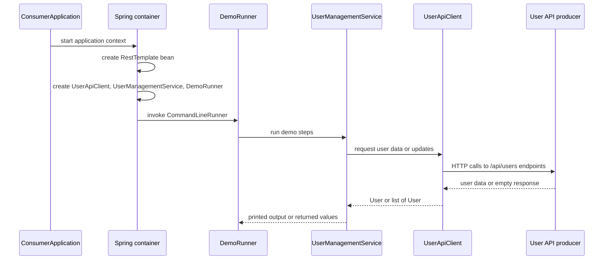

# Application Overview

This application is a Spring Boot command-line consumer for the User API. It does not own the user domain or the server-side API; instead, it wraps a single external dependency on the producer and turns that API into a runnable demo flow and a small service layer that is easy to call from startup code.

The application is organized around runtime responsibilities rather than source-tree layout:

- **Bootstrap** starts Spring Boot and provides shared infrastructure beans.
- **HTTP client** encapsulates the remote User API calls.
- **Service** coordinates client calls and adds simple presentation and derived operations.
- **Runner** drives the demo workflow at application startup.
- **Model** carries user data between the client and the service.

## Runtime structure

The diagram shows the startup path and the one-way dependency chain used by the app: Spring Boot creates the infrastructure, the runner triggers the workflow, the service delegates to the client, and the client performs HTTP operations against the producer.

## Responsibilities by component

### Bootstrap

<!-- openwiki: broken internal link [../src/main/java/com/example/consumer/ConsumerApplication.java] file "../src/main/java/com/example/consumer/ConsumerApplication.java" does not exist. Fix the href or restore the target, then delete this comment. -->
[`ConsumerApplication`](../src/main/java/com/example/consumer/ConsumerApplication.java) is the Spring Boot entrypoint. Its `main` method starts the application context, and it also exposes a `RestTemplate` bean that the rest of the app reuses for outbound HTTP calls. That bean is the only infrastructure component defined locally in this page's scope.

### HTTP client

<!-- openwiki: broken internal link [../src/main/java/com/example/consumer/client/UserApiClient.java] file "../src/main/java/com/example/consumer/client/UserApiClient.java" does not exist. Fix the href or restore the target, then delete this comment. -->
[`UserApiClient`](../src/main/java/com/example/consumer/client/UserApiClient.java) is the application's dedicated integration boundary to the external User API. It reads `user.api.base-url` from configuration and builds requests against that base URL for the supported endpoints:

- `GET /api/users`
- `GET /api/users/active`
- `GET /api/users/{id}`
- `GET /api/users/username/{username}`
- `POST /api/users`
- `PUT /api/users/{id}`
- `DELETE /api/users/{id}`
- `PATCH /api/users/{id}/deactivate`
- `PATCH /api/users/{id}/activate`

This class is responsible for translating between Spring's `RestTemplate` calls and the remote API contract. It returns `User` objects or lists of `User` values, and it does not implement business rules beyond invoking the remote endpoints.

### Service

<!-- openwiki: broken internal link [../src/main/java/com/example/consumer/service/UserManagementService.java] file "../src/main/java/com/example/consumer/service/UserManagementService.java" does not exist. Fix the href or restore the target, then delete this comment. -->
[`UserManagementService`](../src/main/java/com/example/consumer/service/UserManagementService.java) sits above the client and shapes the application behavior that the runner consumes. It prints section headers, delegates the remote calls, and handles small local transformations such as:

- creating a new `User` request object before a create or update call,
- filtering returned users by email domain,
- counting active users from the active-user list.

This service is the main internal extension point if the consumer needs new presentation, aggregation, or orchestration logic without changing the client boundary.

### Runner

<!-- openwiki: broken internal link [../src/main/java/com/example/consumer/runner/DemoRunner.java] file "../src/main/java/com/example/consumer/runner/DemoRunner.java" does not exist. Fix the href or restore the target, then delete this comment. -->
[`DemoRunner`](../src/main/java/com/example/consumer/runner/DemoRunner.java) is a Spring `CommandLineRunner`, so it executes automatically after the application context is ready. It sequences the demo steps in a fixed order: list users, inspect specific users, create a user, optionally update and toggle that created user, then print derived summaries. The runner is the only component that owns the demo script itself.

### Model

<!-- openwiki: broken internal link [../src/main/java/com/example/consumer/model/User.java] file "../src/main/java/com/example/consumer/model/User.java" does not exist. Fix the href or restore the target, then delete this comment. -->
[`User`](../src/main/java/com/example/consumer/model/User.java) is the shared data object used for request and response payloads. It contains identity, profile, timestamp, and active-state fields, plus a convenience constructor for create/update flows and a `toString()` implementation for console output.

## Data and control flow

1. Spring Boot starts `ConsumerApplication`.
2. The container instantiates the shared `RestTemplate` bean and wires the client, service, and runner.
3. Spring invokes `DemoRunner.run(...)` after startup.
4. The runner calls `UserManagementService` methods in sequence.
5. The service delegates remote work to `UserApiClient` and performs small local computations where needed.
6. The client calls the external User API using the configured base URL.
7. Returned `User` data flows back through the service to the runner, where it is printed to standard output.

## Boundaries and invariants

The consumer keeps a strict separation between local orchestration and remote user-state ownership:

- It **does not persist users locally**.
- It **does not implement the User API contract itself**; it depends on the producer for all user state and mutations.
- It **assumes the remote API is reachable and configured via `user.api.base-url`**.
- It **uses console output for demo visibility**, not a web UI or local database.

Because the runner is startup-driven, failures in remote calls can surface during application launch and demo execution. The app therefore behaves like a thin command-line client: successful execution depends on both Spring context startup and the availability of the external User API.

## How to extend it safely

- Add new remote endpoints in `UserApiClient` when the producer contract grows.
- Add higher-level orchestration or derived reporting in `UserManagementService` when logic should stay local to the consumer.
- Add new startup scenarios in `DemoRunner` when you want the demo sequence to exercise more of the API.
- Extend `User` only when the shared contract actually gains new fields.

For the contract and operation details behind this consumer, see [User API Contract](../integrations/user-api-contract.md), [User Domain](../concepts/user-domain.md), [Configuration and Runtime](../operations/configuration-and-runtime.md), and [Demo Execution](../workflows/demo-execution.md).
