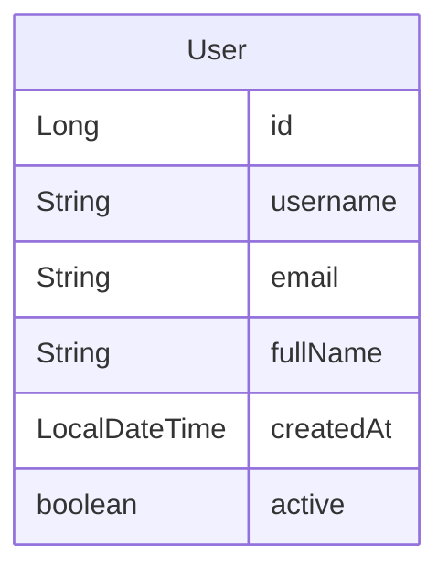

# User Domain Model

The consumer treats `User` as a simple transport and display model for the user API. It carries the fields the client prints, sends back on create and update, and reads for local filtering.

## Fields used by the consumer

- `id` (`Long`): returned by lookup and list calls and shown in detail output, but not set by the create helper.
- `username` (`String`): used for display, lookup by username, and user creation and update payloads.
- `email` (`String`): used for display and for the local `getUserEmailsByDomain` filter.
- `fullName` (`String`): used for display and user creation and update payloads.
- `createdAt` (`LocalDateTime`): present on the model for server-populated timestamps, but the consumer does not set or inspect it directly.
- `active` (`boolean`): used in printed output and implied by the active-user endpoints and activate or deactivate operations.

## Consumer assumptions

The client code expects the API to return `User` objects for list and lookup operations, including active-user listings. It also assumes that active status can be toggled through dedicated activate and deactivate endpoints rather than by mutating the `active` field locally.

`createdAt` is modeled as part of the data contract, which suggests the server may populate it, but this repository does not enforce a non-null guarantee or otherwise depend on it in business logic.

## How the model is used

- **Display**: `displayAllUsers`, `displayActiveUsers`, `displayUserById`, `displayUserByUsername`, and `createNewUser` print `User` instances directly.
- **Mutation**: `createNewUser` and `updateExistingUser` build a `User` with `username`, `email`, and `fullName` before sending it to the API.
- **Filtering**: `getUserEmailsByDomain` filters the full user list by `email` suffix.
- **Counts**: `countActiveUsers` derives the count from the size of the active-user list.

The diagram shows the fields carried by the consumer-side `User` model.
