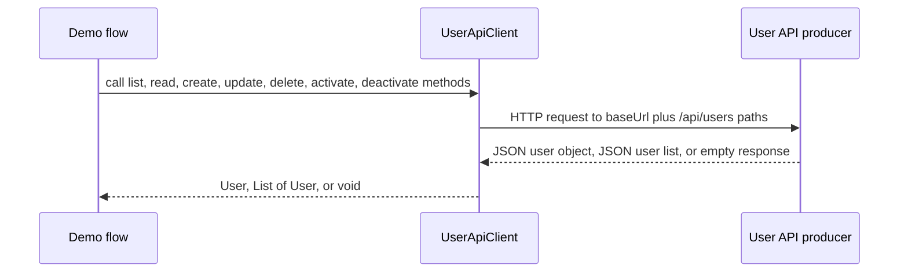

# User API Contract

This consumer is a thin outbound client for the external User API producer. It does not own the server-side user lifecycle; instead, it reads the base URL from configuration and issues HTTP requests through `UserApiClient`.

<!-- openwiki: broken internal link [../src/main/resources/application.properties] file "../src/main/resources/application.properties" does not exist. Fix the href or restore the target, then delete this comment. -->
The runtime dependency is configured with `user.api.base-url`, which defaults to `http://localhost:8080` in [`application.properties`](../src/main/resources/application.properties). The README describes the same producer location as a prerequisite for running the demo consumer.

## Outbound endpoint matrix

| Operation | Method | Path | Client return type | Notes |
| --- | --- | --- | --- | --- |
| List all users | `GET` | `/api/users` | `List<User>` | Uses `RestTemplate.exchange(...)` with `ParameterizedTypeReference<List<User>>`. |
| List active users | `GET` | `/api/users/active` | `List<User>` | Same list handling as the full collection read. |
| Read user by id | `GET` | `/api/users/{id}` | `User` | Uses `getForObject(...)`. |
| Read user by username | `GET` | `/api/users/username/{username}` | `User` | Uses `getForObject(...)`. |
| Create user | `POST` | `/api/users` | `User` | Sends a `User` request body and expects a `User` response. |
| Update user | `PUT` | `/api/users/{id}` | `void` | Sends a `User` request body and ignores the response body. |
| Delete user | `DELETE` | `/api/users/{id}` | `void` | No request body. |
| Deactivate user | `PATCH` | `/api/users/{id}/deactivate` | `void` | Sends `null` as the request body and ignores the response body. |
| Activate user | `PATCH` | `/api/users/{id}/activate` | `void` | Sends `null` as the request body and ignores the response body. |

## Request and response assumptions

`UserApiClient` assumes the producer returns JSON payloads that Spring can deserialize directly into the consumer-side `User` model and `List<User>` collections. The client does not add a custom serializer, deserializer, or response wrapper for these endpoints.

The collection reads depend on `RestTemplate.exchange(...)` and `ParameterizedTypeReference<List<User>>() {}`, which means the consumer expects the producer to return a JSON array of user objects rather than a paged envelope or another wrapper shape.

For the single-item reads and the create call, the client expects a direct `User` response body. For update, delete, activate, and deactivate, the client does not inspect a response body at all.

## Null and empty handling

The consumer does not implement explicit null or empty guarding in `UserApiClient`:

- `getAllUsers()` and `getActiveUsers()` return `response.getBody()` directly, so an empty or missing body is passed through as-is.
- `getUserById()` and `getUserByUsername()` delegate to `RestTemplate.getForObject(...)`, so missing-response handling is delegated to Spring's client behavior.
- `createUser()` returns the direct `postForObject(...)` result without local validation of the returned body.
- `updateUser()`, `deleteUser()`, `deactivateUser()`, and `activateUser()` ignore response content and rely on the HTTP call itself to succeed.

Any stronger null checks, empty collection defaults, or error translation would need to be added above this client layer; they are not present here.

## Runtime request flow

The diagram shows the outbound path used by the consumer: a configured base URL plus fixed `/api/users` routes, with Spring handling the HTTP exchange and payload conversion.

## Change boundaries

This page documents the consumer-facing contract only. If the producer adds or renames endpoints, the primary change point in this repository is `UserApiClient`, followed by any service or demo code that calls the affected method.
