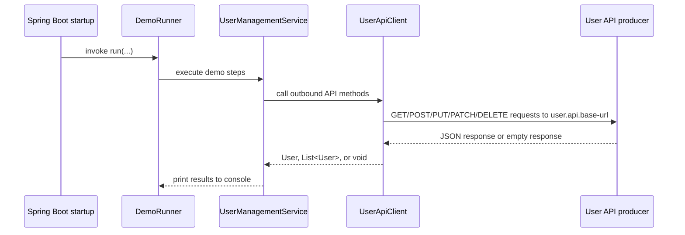

# Configuration and Runtime

This page covers the consumer's runtime requirements, configuration, and startup behavior. It is a Spring Boot command-line style application that immediately exercises the User API when launched.

## Requirements

- Java 17
- Maven 3.x or the project wrapper (`./mvnw`)
- Spring Boot 3.2.0, as defined by the Maven parent in `pom.xml`

The application uses `spring-boot-starter-web`, `spring-boot-starter`, and `RestTemplate` for outbound HTTP calls.

## Producer dependency

The consumer expects the User API producer to be available before startup. The default base URL is:

```properties
user.api.base-url=http://localhost:8080
```

That value is read from `src/main/resources/application.properties` and injected into `UserApiClient` with `@Value("${user.api.base-url}")`. If the producer is not running at that address, startup-time demo calls will fail when `RestTemplate` tries to reach the API.

## How to run

Use the Maven wrapper from the repository root:

```bash
./mvnw clean install
./mvnw spring-boot:run
```

The README uses the same flow and assumes the producer is already running.

## Runtime profile and startup behavior

The application starts through `ConsumerApplication.main(...)`, which bootstraps Spring and registers a `RestTemplate` bean. Because `DemoRunner` implements `CommandLineRunner`, the demo logic runs automatically after the application context is ready.

On startup, the runner:

1. prints a demo banner,
2. reads and displays all users,
3. reads and displays active users,
4. fetches a user by id and by username,
5. creates a user,
6. updates, deactivates, and reactivates that created user if the create call returns an id,
7. prints users whose email ends with `@example.com`, and
8. prints the active-user count.

This means the default runtime profile is not an idle service. It is a demonstration client that performs outbound API traffic immediately on launch.



## Configuration surface

The only explicit application property in the repository is `user.api.base-url`. There are no profile-specific property files in the provided sources, so the effective runtime target is whatever value this property resolves to at startup.

## Likely failure modes

From the code, the main operational failures are straightforward:

- missing `user.api.base-url` configuration causes Spring to fail resolving the `@Value` injection,
- an unavailable producer at the configured base URL causes connection or request errors during the demo calls,
- unexpected response shapes from the producer can surface as deserialization errors in `RestTemplate`, especially for `List<User>` or `User` responses,
- startup is sensitive to the producer being reachable because the demo executes immediately in `CommandLineRunner`.

## Troubleshooting

If startup fails, check the producer first and confirm it is reachable at the configured base URL. If the application starts but exits with HTTP errors during the demo, the failure is likely in one of the outbound requests made by `UserApiClient`.

For changes to the API path or payload shape, update the client methods in `UserApiClient` and then re-run the demo flow.
