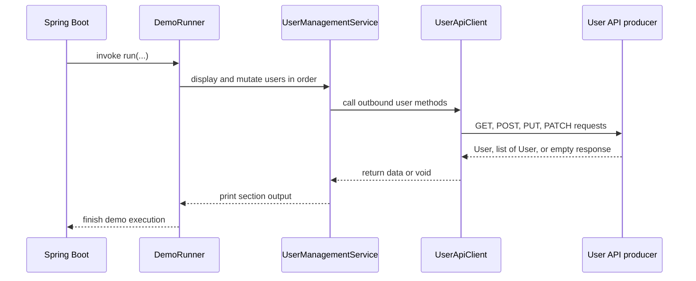

# Demo Execution Workflow

The demo application is not an idle service. When Spring Boot finishes wiring the context, `DemoRunner` immediately executes a scripted sequence of user reads and mutations through `UserManagementService` and `UserApiClient`. The visible result is a console-driven walkthrough of the external User API contract.

## Startup-to-demo sequence

`DemoRunner` implements `CommandLineRunner`, so Spring invokes `run(...)` automatically after the application context is ready. The runtime order is fixed in code:

1. print the demo banner,
2. display all users,
3. display active users,
4. display the user with id `1`,
5. display the user named `john_doe`,
6. create a new user for `alice_wonder`,
7. if the create call returns a non-null `User` with a non-null `id`, update that same user, deactivate it, and activate it again,
8. print the list of user emails ending in `@example.com`,
9. print the active-user count,
10. print the closing banner.

That order matters operationally: the create call is the only branch point, and the update/deactivate/activate actions only run when the created user comes back with an identifier. If the producer does not return an id, those follow-up mutations are skipped.

## Console-visible behavior

The demo communicates its progress entirely through standard output. `DemoRunner` prints a top and bottom banner, while `UserManagementService` prints a section header before each action and then prints the returned data or completion message.

The main visible outputs include:

- `User API Consumer Demo` at startup,
- section headers such as `=== All Users ===`, `=== Active Users ===`, and `=== Creating New User ===`,
- printed `User` objects returned from the producer,
- confirmation lines such as `Created: ...`, `Updated user ID: ...`, `Deactivated user ID: ...`, and `Activated user ID: ...`,
- the derived summary for `example.com` email addresses,
- the final `Total active users: ...` line,
- `Demo Complete!` at shutdown.

## Dependency on the external producer

The happy path depends on the remote User API being reachable at the configured `user.api.base-url`. `UserApiClient` uses that base URL for all requests, and the demo performs outbound HTTP calls immediately during startup. If the producer is unavailable, misconfigured, or returns unexpected payload shapes, the demo can fail during launch or while printing results.

The consumer does not persist user state locally and does not implement the server-side API itself. Every read or mutation in the demo is delegated to the producer through `RestTemplate`.

## Runtime flow

This shows the exact handoff chain used at startup: runner to service to client and back, with the producer as the external dependency that supplies all user data.

## Why the service layer exists

`UserManagementService` keeps the runner readable by wrapping the raw client calls with console formatting and small local transformations:

- it creates the `User` request object before create and update calls,
- it filters the full user list by email domain,
- it counts active users from the active-user list.

That means the runner owns the scripted business sequence, while the service owns the small orchestration and presentation work around the API calls.

## Operational failure points

The most important failure modes are startup-sensitive:

- missing `user.api.base-url` configuration prevents the client from being wired,
- a down or unreachable producer breaks the demo during the startup sequence,
- invalid response shapes can surface as `RestTemplate` deserialization failures,
- any HTTP error during a step interrupts the remaining demo actions unless the call site handles it.

For the producer contract behind these calls, see [User API Contract](../integrations/user-api-contract.md). For the wider application role of the runner and service, see [Application Overview](../architecture/application-overview.md) and [Configuration and Runtime](../operations/configuration-and-runtime.md).
